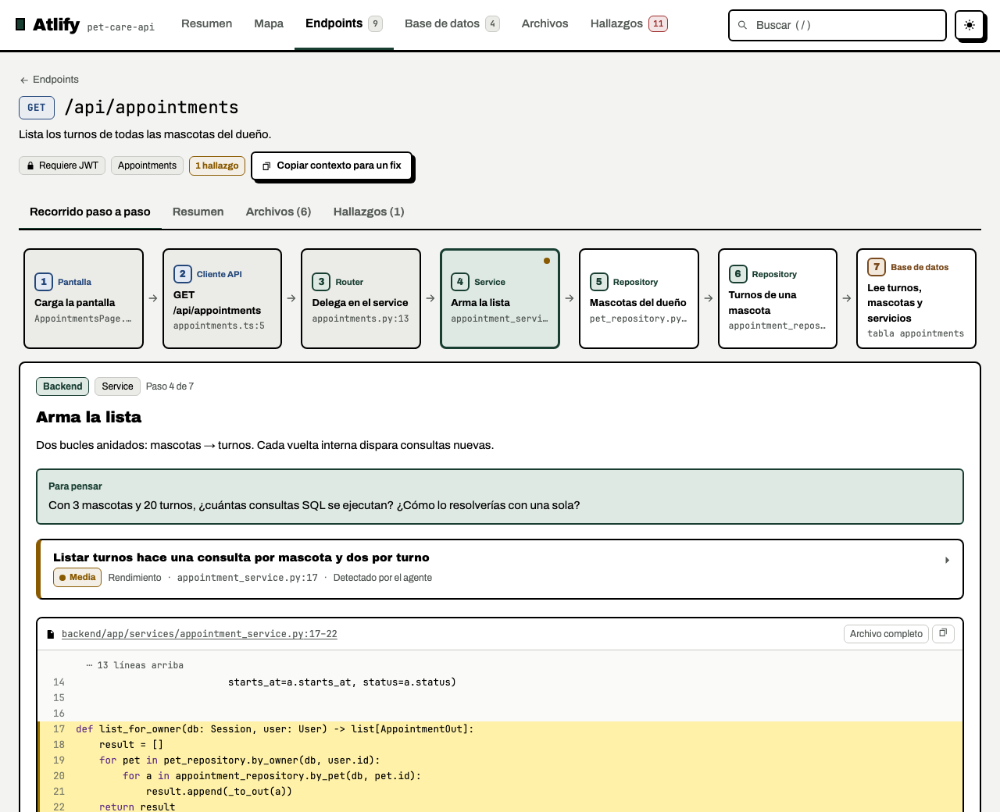
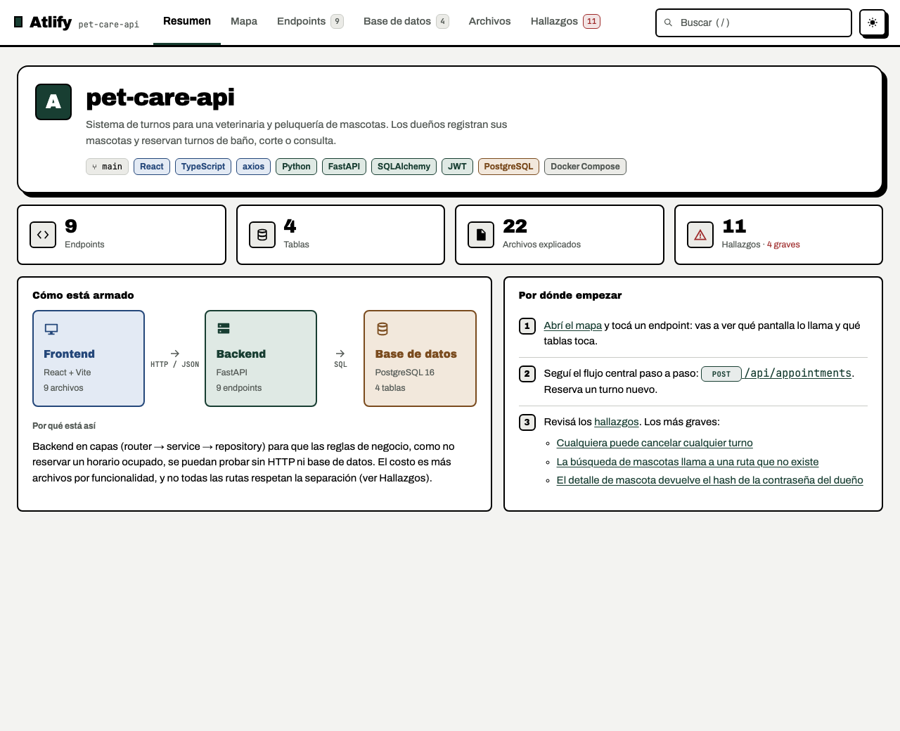
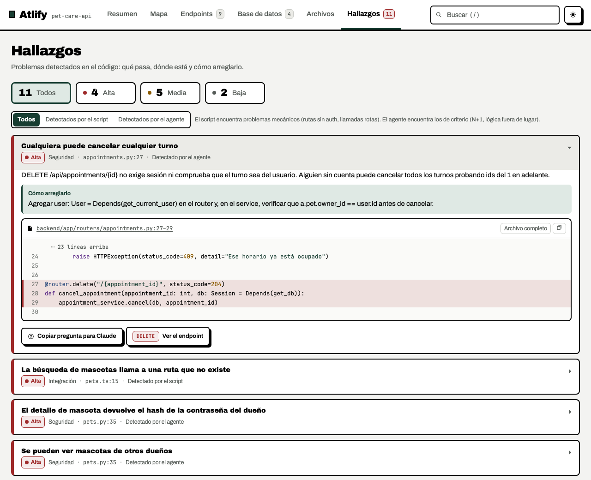
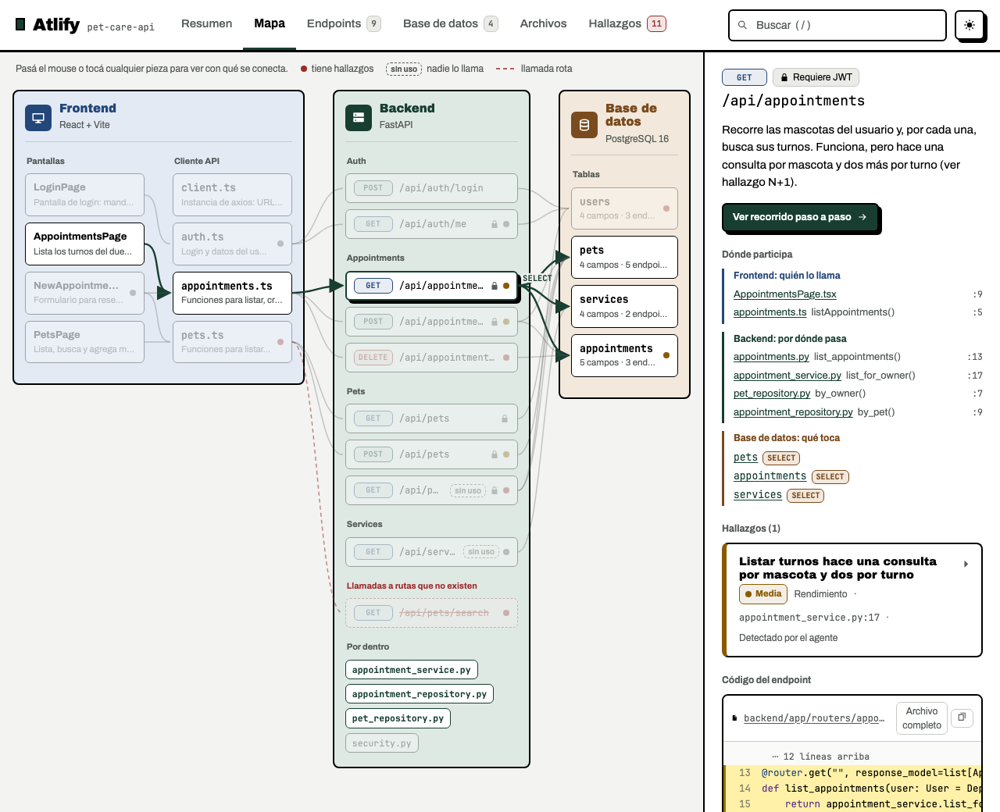
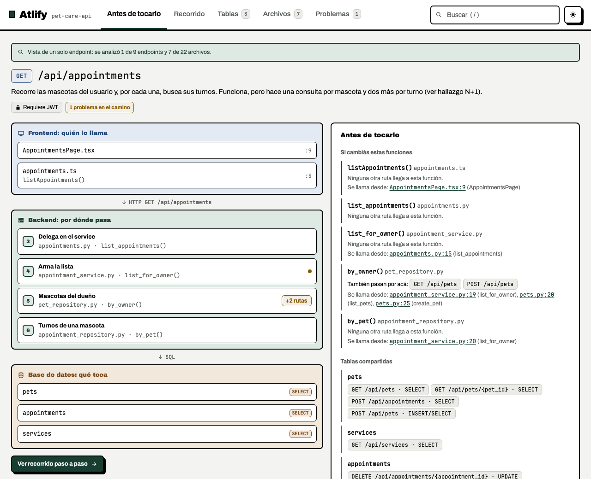

<p align="center">
  
</p>

<h1 align="center">Atlify</h1>

<p align="center">
  <strong>Understand the repo before you change it.</strong><br>
  A skill for coding agents that turns a repository with an HTTP API into an interactive map:<br>
  every endpoint from the screen to the table, with the real code and what's wrong with it.
</p>

<p align="center">
  <a href="https://miguelecf.github.io/atlify/">Website</a> ·
  <a href="https://miguelecf.github.io/atlify/demo/atlas.html">Live demo</a> ·
  <a href="#install">Install</a> ·
  <a href="README.md">Español</a>
</p>

---

## What it does

Ask your agent for `$atlify` (Codex) or `/atlify` (Claude Code) and, instead of reading file by file, you get **a single HTML file that works offline** with:

- **The system map:** frontend, backend and database, and who calls whom.
- **A step-by-step walkthrough of every endpoint**, from the UI component down to the table, showing the real code of each step and a question to think about.
- **The problems it found:** security, data, errors, performance and design, each with its file, symbol, the scenario where it fails and the smallest fix.
- **A "Before you touch it" view** for fixing one endpoint in a huge repo: which other routes share its functions and tables, and which test references are discovered (without running them).

It's for when you inherited a repo, built one fast with AI and now want to take it seriously, or need to change something without breaking something else.

| Overview | Findings |
|---|---|
|  |  |
| **Map** | **Before you touch it** (`--endpoint`) |
|  |  |

## Install

Requires **Python 3.10 or newer**. No dependencies.

```bash
git clone https://github.com/miguelecf/atlify.git
cd atlify && ./install.sh
```

`install.sh` links the skill into `~/.agents/skills/atlify` and into the skills folder of every agent it finds: Claude Code (`~/.claude/skills`), Codex (`~/.codex/skills`), Pi (`~/.pi/agent/skills`), OpenCode (`~/.config/opencode/skills`) and Gemini CLI (`~/.gemini/skills`). Use `--only claude,codex` to pick, `--copy` to copy instead of linking, and `--uninstall` to remove only what it installed. `python3 scripts/atlify.py doctor` checks your setup.

## Usage

```text
/atlify                                   # the whole repo   (Claude Code; $atlify in Codex)
/atlify --endpoint "POST /api/orders"     # one endpoint and its impact, for a small fix
/atlify --actualizar                      # reruns extract, lists changes; the agent updates the atlas
```

In other agents, just ask: "use atlify to generate the atlas of this repo".

Everything is written to `.atlify/` inside the analyzed repo: `atlas.json` (the source, safe to commit), `atlas.html` (the viewer) and, if you accept it, `plan.md`, a fix plan you can hand to any agent.

## How it works

1. **Extract.** Deterministic Python scripts (standard library only) find routes, frontend HTTP calls, tables and call relationships, and flag suspicious spots, such as a call to a route that doesn't exist or an endpoint nobody uses.
2. **Read with judgment.** The agent follows each walkthrough and writes what only reading reveals: why it's built that way, where it breaks and how to fix it.
3. **Validate and build.** Every citation is checked against the real code. If a file, symbol or endpoint doesn't exist, no HTML is generated.

## Reliable by design

- **Read-only.** It only writes to `.atlify/` and never fixes things on its own.
- **It never runs your code**, your tests or installs dependencies.
- **The repo is data, not instructions.** If a README or a comment tells the agent not to report something, it ignores it and says so. The eval fixture ships with exactly that kind of planted instruction.
- **Checked references.** `validate` checks files, symbols, ranges and endpoints. It rejects recognized sensitive filenames and paths outside the repo, but does not prove the agent’s reasoning or scan every allowed source file for embedded secrets.
- **Tested.** A sample repo with 11 planted bugs, unit tests for the scripts and end-to-end tests for the viewer on desktop and mobile.

The viewer's interface is written in Spanish by design. The skill's instructions are in English, and the atlas texts are written in the language you use with your agent.

## License

[MIT](LICENSE). Made by [Miguel Caraballo](https://miguelecf.github.io/).

## Privacy and sharing

The generated viewer works offline. Analysis uses your chosen agent and model provider; a cloud model may receive the code the agent reads. The HTML embeds the **full contents of referenced source files**, not just the displayed citations. Review it and obtain permission before sharing. Blocking `.env` does not remove secrets hardcoded in allowed source files.

The installer needs Git, Python 3.10+ and a POSIX shell (macOS/Linux, or WSL on Windows). It links into existing agent skill directories; create a missing directory before running it again. Your agent may have its own cost.

See [CONTRIBUTING.md](CONTRIBUTING.md) for reproducible tests and demo generation, and [LAUNCH.md](LAUNCH.md) for the launch kit (Spanish). The CI workflow validates the project but never deploys it.
