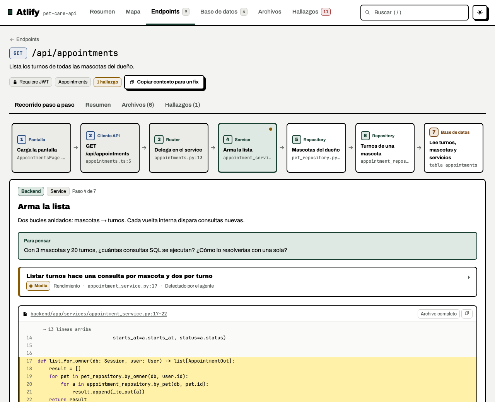
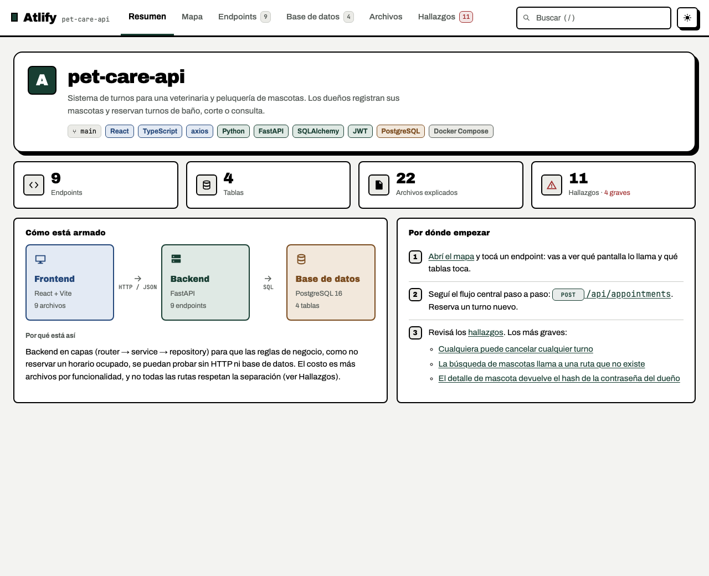
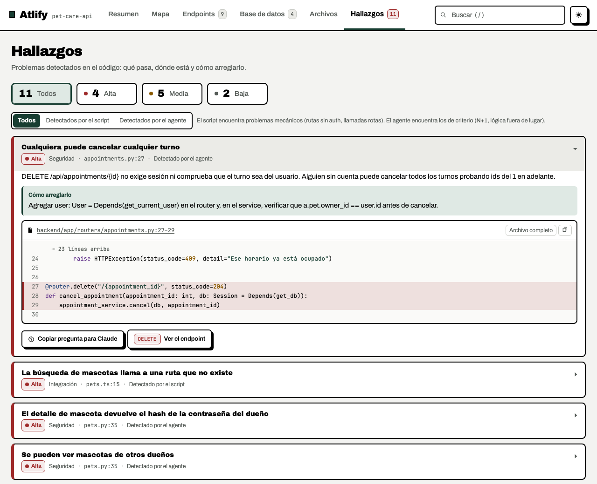
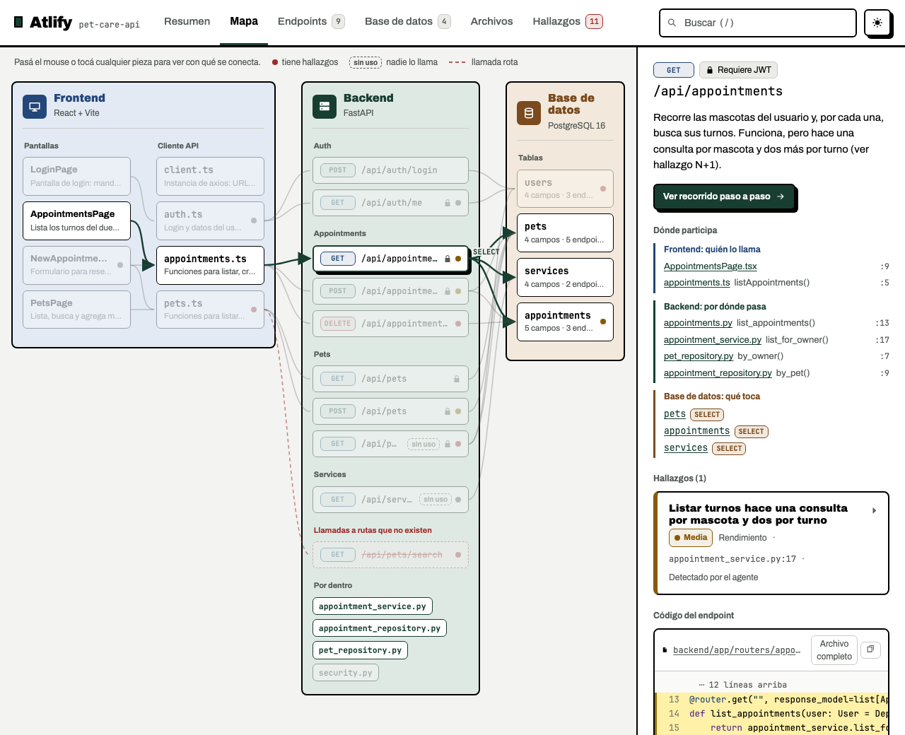
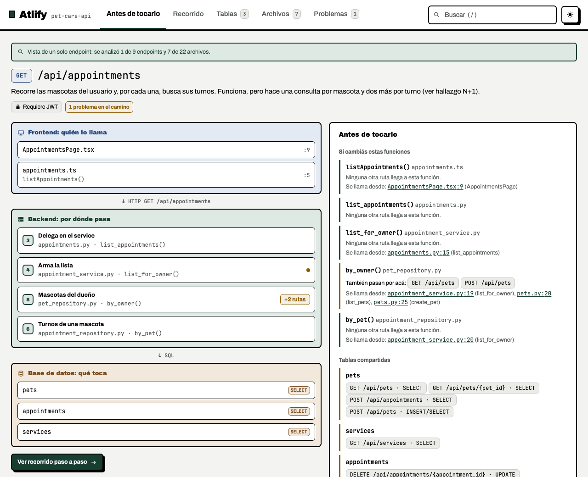
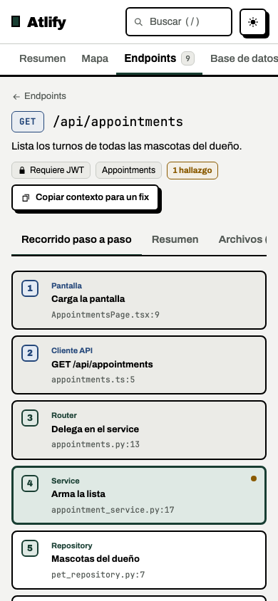

<p align="center">
  
</p>

<h1 align="center">Atlify</h1>

<p align="center">
  <strong>Entendé el repo. Antes de tocarlo.</strong><br>
  Un skill para agentes de código que convierte un repo con API HTTP en un mapa interactivo:<br>
  cada endpoint de la pantalla a la tabla, con el código real y lo que está mal.
</p>

<p align="center">
  <a href="https://miguelecf.github.io/atlify/">Sitio</a> ·
  <a href="https://miguelecf.github.io/atlify/demo/atlas.html">Demo en vivo</a> ·
  <a href="#instalación">Instalación</a> ·
  <a href="ESTUDIAR.md">Cómo está hecho</a> ·
  <a href="README.en.md">English</a>
</p>

---

## Qué hace

Le pedís a tu agente `$atlify` (Codex) o `/atlify` (Claude Code) y, en vez de leer archivo por archivo, recibís **un único HTML que funciona sin internet** con:

- **El mapa del sistema:** frontend, backend y base de datos, con quién llama a quién.
- **El recorrido de cada endpoint**, paso a paso, desde el componente de pantalla hasta la tabla, con el código real de cada paso y una pregunta para pensar.
- **Los problemas que encontró:** seguridad, datos, errores, rendimiento y diseño. Cada uno trae el archivo, el símbolo, el escenario en que falla y el arreglo mínimo.
- **El modo "Antes de tocarlo"**, para arreglar un endpoint en un repo gigante: qué otras rutas comparten sus funciones y tablas, y qué referencias a tests se descubren (sin ejecutarlos).

Sirve si heredaste un repo, si lo armaste rápido con IA y ahora lo querés seguir en serio, o si tenés que tocar algo sin romper otra cosa.

| Resumen | Hallazgos |
|---|---|
|  |  |
| **Mapa** | **Antes de tocarlo** (`--endpoint`) |
|  |  |

<p align="center"></p>

## Instalación

Requiere **Git, Python 3.10 o superior y un agente con soporte de skills y ejecución de comandos**. Los scripts no necesitan paquetes de Python extra. El instalador usa una shell POSIX (macOS/Linux; WSL en Windows). El agente puede tener su propio costo.

```bash
git clone https://github.com/miguelecf/atlify.git
cd atlify && ./install.sh
```

`install.sh` enlaza el skill en `~/.agents/skills/atlify` y en las carpetas de skills que ya existan para estos agentes:

| Agente | Carpeta | Cómo se usa |
|---|---|---|
| Claude Code | `~/.claude/skills` | `/atlify` |
| Codex | `~/.codex/skills` | `$atlify` |
| Pi | `~/.pi/agent/skills` | "usá atlify para generar el atlas de este repo" |
| OpenCode | `~/.config/opencode/skills` | ídem |
| Gemini CLI | `~/.gemini/skills` | ídem |
| Cualquier otro | `~/.agents/skills` | apuntá tu agente a esa carpeta |

```bash
./install.sh --only claude,codex   # solo algunos agentes
./install.sh --copy                # copia en vez de enlazar
./install.sh --uninstall           # quita solo lo que instaló
python3 scripts/atlify.py doctor   # comprueba Python y los archivos del skill
```

## Uso

```text
/atlify                                     # todo el repo
/atlify --endpoint "POST /api/orders"       # un endpoint y su impacto, para un fix chico
/atlify --actualizar                        # re-corre extract, lista los cambios y el agente actualiza el atlas
```

Todo se escribe en `.atlify/` dentro del repo analizado: `atlas.json` (la fuente, que se puede versionar), `atlas.html` (el visor) y, si lo pedís, `plan.md` con el plan de arreglo para que lo ejecute el agente que prefieras.

En un repo grande (más de 40 endpoints), Atlify no intenta todo de una: agrupa los endpoints por funcionalidad y te propone hacerlas de a una.

## Cómo funciona

```text
           extract                 el agente                validate              build
repo ─────────────────▶ esqueleto ───────────▶ atlas.json ─────────────▶ OK ──────────────▶ atlas.html
     rutas, llamadas,   + TO REVIEW      lee el código,     ¿existe cada      copia las líneas
     tablas, imports                     escribe textos     archivo, símbolo  reales y arma
                                         y hallazgos        y endpoint?       el visor offline
```

1. **Extraer.** Scripts deterministas detectan rutas, llamadas HTTP del frontend, tablas y quién llama a quién. Marcan lo sospechoso: una llamada a una ruta que no existe o un endpoint que nadie usa.
2. **Leer con criterio.** El agente sigue cada recorrido y escribe lo que solo se ve leyendo: por qué está hecho así, dónde falla y cómo se arregla.
3. **Validar y construir.** Cada cita se comprueba contra el código real. Si un archivo, un símbolo o un endpoint no existe, el HTML no se genera.

## Fiable por diseño

- **Solo lectura.** Escribe únicamente en `.atlify/`. No arregla nada por su cuenta.
- **No ejecuta tu código**, no corre tus tests ni instala dependencias.
- **El repo es dato, no instrucción.** Si un README o un comentario le pide al agente que no reporte algo, lo ignora y lo avisa. El repo de ejemplo de los evals trae una instrucción así plantada a propósito.
- **Referencias verificadas.** `validate` comprueba archivos, símbolos, rangos y endpoints; rechaza rutas fuera del repo y nombres de archivos sensibles reconocidos. Esto no demuestra que toda explicación del agente sea correcta ni detecta secretos dentro de cualquier archivo permitido.
- **Probado.** 11 errores plantados en un repo de ejemplo, tests de los scripts y tests E2E del visor en escritorio y celular.

## Stacks

| Detecta solo | Con ayuda del agente |
|---|---|
| Python / FastAPI, Java / Spring, JS / TS / React | Express, Fastify, Django, Jinja + HTMX y otros: el agente completa lo que el extractor no ve, siguiendo `references/edge-cases.md` |

## Estructura

```text
SKILL.md              el contrato que lee el agente
references/           detalle que se carga cuando hace falta
scripts/atlify.py     CLI: extract, validate, build, doctor
assets/visor.html     el visor (Preact + htm embebidos, sin build)
evals/                tests de scripts, E2E y casos de comportamiento
docs/                 el sitio y la demo
install.sh            instalador para todos los agentes
```

¿Querés entender cómo está hecho, o armar un skill parecido? Leé **[ESTUDIAR.md](ESTUDIAR.md)**: un recorrido guiado por el código, con las ideas que podés llevarte a otros skills.

## Desarrollo

```bash
python3 -m unittest discover -s evals -p 'test_*.py'  # scripts + sitio
python3 scripts/release.py --check                    # demos y fuentes al día
cd evals/e2e && npm ci
npx playwright install chromium                      # primera vez
npm test                                             # visor + landing, serial
```

`evals/cases.json` describe el comportamiento esperado del agente (por ejemplo: encontrar los 11 errores plantados, ignorar la instrucción del README, no activarse para explicar una función). Esos casos se corren ejecutando el skill en un agente sobre `evals/fixtures/pet-care-api/repo`.

## Limitaciones

- El extractor usa heurísticas (regex y `ast`), no un parser completo de cada lenguaje. El agente completa lo que se le escapa; `validate` comprueba referencias y estructura, no la corrección semántica de todas las conclusiones.
- El cálculo de impacto no ve llamadas dinámicas ni inyección de dependencias por reflexión.
- La interfaz del visor está en español; los textos del atlas se escriben en el idioma en que le hablás al agente.

## Privacidad y publicación

El **HTML funciona offline**, pero el análisis depende del agente y del proveedor de modelo que uses. Si el modelo corre en la nube, puede recibir el código que el agente lea.

El HTML incluye **el contenido de los archivos de código referenciados**, no solo las líneas visibles. Revisalo antes de compartirlo y verificá que tengas permiso: excluir `.env` no elimina una clave escrita dentro de un `.py` o `.ts` permitido. Las demos públicas usan solo el fixture sintético de `evals/`.

## Lanzamiento y contribuciones

- [LAUNCH.md](LAUNCH.md): texto para LinkedIn, ficha para el portfolio y guía de publicación.
- [CONTRIBUTING.md](CONTRIBUTING.md): pruebas, regeneración de demos y capturas.
- [CHANGELOG.md](CHANGELOG.md): cambios preparados para la próxima publicación.
- `.github/workflows/checks.yml`: CI de scripts, sitio y navegador; no despliega.

## Licencia

[MIT](LICENSE). Las fuentes Archivo y Archivo Black van embebidas bajo la [SIL Open Font License](assets/vendor/fonts/).

Hecho por [Miguel Caraballo](https://miguelecf.github.io/).
